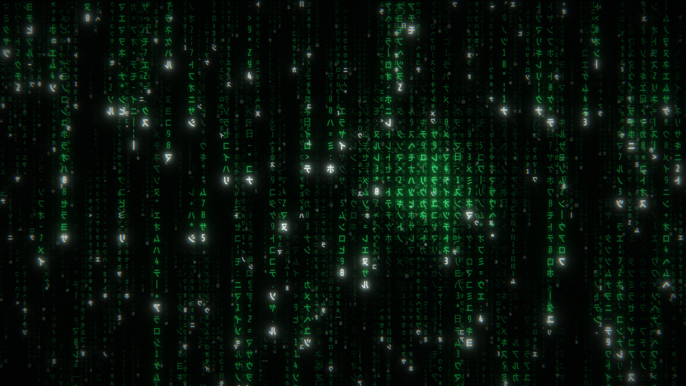

# The Matrix

Matrix digital rain in WebGL2: green glyphs falling on black.



## Run

```sh
node build.js
node server.js dist
```

`build.js` inlines the shaders from `shaders/` into `dist/matrix.js`.

Open http://localhost:8000.

## Docker

```sh
docker run --rm -p 8000:8000 ghcr.io/clems4ever/thematrix
```

## Controls

- Click or press any key: fullscreen
- `F`: toggle fullscreen
- `Space`: pause

## License

MIT
